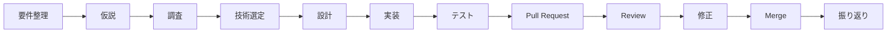

# Next SNS App

Next.jsとNestJSを使用して、X（Twitter）のようなSNSアプリを開発するプロジェクトです。

ユーザー同士が投稿・いいね・リツイート・リプライ・フォローなどの機能を通してコミュニケーション可能なSNSを構築します。

このプロジェクトでは、アプリの完成だけでなくNext.jsとNestJSの理解を深め、
フロントエンド・API・DB・認証などの設計と実装を学ぶことを目的としています。

また、技術や設計を「なんとなく」で選択するのではなく、
選択肢を調査・比較し、根拠を持って技術選定できることを目指します。

## 目次

- [開発目的](#開発目的)
- [仮説](#仮説)
- [主な機能](#主な機能)
- [構成](#構成)
- [使用技術](#使用技術)
- [ディレクトリ構成](#ディレクトリ構成)
- [開発フロー](#開発フロー)
- [ブランチ運用](#ブランチ運用)

## 開発目的

本プロジェクトでは、以下の理解を深めることを目的としています。

- Next.jsとNestJSを使用したSNSアプリ開発
- React / Next.js
- 詳細設計図 / 画面遷移図
- API設計・実装
- バリデーション
- DB設計・データモデリング
- 認証・認可
- Server / Clientの責務
- エラーハンドリング
- テスト
- Git / GitHubを使用した開発フロー
- Pull Request / コードレビュー

また、

> なぜこの技術を使用したのか？

> なぜこの設計にしたのか？

を自分の言葉で説明できる状態を目指します。


## 仮説

### Next.jsだけで完結するのではなく、NestJSバックエンドを併用する

SNSのようなアプリケーションでは、
UIとAPIロジックを分離した方が責務が明確になり、学習の観点でも理解しやすくなります。

そのため、本プロジェクトではNext.jsをフロントエンド、NestJSをバックエンドとして構成し、
API・認証・DB設計・データフローを明確に扱うことを目的とします。

実際に開発することで、以下について検証します。

- Next.jsとNestJSを組み合わせたときのメリット
- フロントエンドとバックエンドの責務の分離
- API設計と実装の適切な境界
- 認証やDBアクセスをNestJS側でどう扱うか
- アプリケーションが大きくなった場合の設計上の課題


## 主な機能

### MVP

最初はSNSとして最低限必要な機能から実装します。

- ユーザー登録
- ログイン
- ログアウト
- 投稿
- 投稿一覧
- タイムライン
- プロフィール


### 追加予定機能


- いいね
- フォロー / フォロー解除
- リプライ
- リポスト
- 画像投稿
- ユーザー検索
- 投稿検索
- 通知


## 構成

本プロジェクトでは、
Next.jsをフロントエンド、NestJSをバックエンドとして扱い、
学習目的で両者の連携・責務分離を体験する構成を採用します。

## 使用技術

本プロジェクトでは、MVPの実装に必要な技術を整理しつつ、
各技術の選定理由を比較検討していく方針です。

現時点では、フロントエンドにはNext.js、
バックエンドにはNestJSを採用し、
API・DB・認証・バリデーション・テストまで一貫して扱える構成を目指します。

| 分類 | 技術 | バージョン | 状態 | 補足 |
| --- | --- | --- | --- | --- |
| Language | TypeScript | 検討中 | 採用 | 型安全性と保守性 |
| Frontend | React | 検討中 | 採用 | UI実装 |
| Framework | Next.js | 検討中 | 採用 | App Router |
| Backend | NestJS | 検討中 | 採用 | REST APIの予定 / 認証・DBアクセスの実装 |
| Database | PostgreSQL / SQLite などを検討 | - | 調査中 | SNSのデータ設計に適した構成を選定中 |
| Authentication | JWT / NextAuth / Auth.js などを検討 | - | 調査中 | セッション管理と認証基盤の比較 |
| Validation | Zodを検討 | - | 調査中 | API / フォームの入力検証 |
| Testing | Vitest / Jest などを採用予定 | - | 調査中 | 単体テストと統合テストを想定 |

バージョンは環境構築後に固定し、選定理由と比較結果も併せて記載します。

## ディレクトリ構成

フロントエンドとバックエンドを分離し、
責務ごとに整理した構成を目指します。

```text
next-sns-app/
├── README.md
├── docs/
│   └── requirements.md
├── public/
├── src/
│   └── app/
├── package.json
├── next.config.ts
├── tsconfig.json
└── eslint.config.mjs
```

ディレクトリを作成する際には、
各ディレクトリの責務を考えて設計します。


## 開発フロー

基本的に以下の流れで開発します。



1. 要件を整理する
2. 仮説を立てる
3. 必要な技術を調査する
4. 選択肢を比較する
5. 根拠を持って技術を選択する
6. 設計する
7. featureブランチを作成する
8. 実装する
9. テストする
10. Pull Requestを作成する
11. レビューを受ける
12. 修正する
13. developへmergeする
14. 実装結果を振り返る


