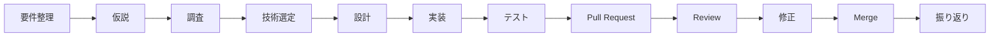

# PiBit

**小さな欠片から、無限の繋がりへ。**

PiBitは、一人ひとりの経験・考え方・価値観を「Piece（欠片）」として共有し、新しい人や価値観との繋がりを生み出すSNSです。

一人ひとりを形の異なるパズルのピースに見立てています。
それぞれの欠片が出会い、繋がることで、新しい発見や可能性が生まれます。
その繋がりは軌道のように広がり続け、完成することのない大きなパズルを形作っていきます。

PiBitは、人との出会いを通して、自分の世界を広げていく場所です。

ユーザーは自分のPieceを残し、他者のPieceを探索し、共鳴し、言葉を届けながら、新しい繋がりや発見を積み重ねていきます。

本プロジェクトは、Next.jsとNestJSを使用してPiBitを開発するプロジェクトです。

このプロジェクトでは、アプリの完成だけでなくNext.jsとNestJSの理解を深め、
フロントエンド・API・DB・認証などの設計と実装を学ぶことを目的としています。

また、技術や設計を「なんとなく」で選択するのではなく、
選択肢を調査・比較し、根拠を持って技術選定できることを目指します。

## 目次

- [開発目的](#開発目的)
- [ドキュメント](#ドキュメント)
- [仮説](#仮説)
- [ブランド・デザイン方針](#ブランドデザイン方針)
- [機能名称](#機能名称)
- [主な機能](#主な機能)
- [構成](#構成)
- [使用技術](#使用技術)
- [ディレクトリ構成](#ディレクトリ構成)
- [開発フロー](#開発フロー)
- [ブランチ運用](#ブランチ運用)

## ドキュメント

| ドキュメント | 役割 |
| --- | --- |
| [requirements.md](./docs/requirements.md) | 実現する機能・要件 |
| [mvp.md](./docs/mvp.md) | MVPの対象・完成条件・開発方針 |
| [screens.md](./docs/screens.md) | 画面要件 |
| [screen-flow.md](./docs/screen-flow.md) | 画面遷移・操作フロー |
| [routing.md](./docs/routing.md) | URL・アクセス制御・レイアウト設計 |
| [references.md](./docs/references.md) | 学習テーマ・理解・疑問点・参考資料 |
| [implementation-notes.md](./docs/implementation-notes.md) | 実装時の検討・採用理由・検証結果 |
| [AGENTS.md](./AGENTS.md) | AIが守る開発上のルール |
| [Pull Request template](./.github/pull_request_template.md) | PRで共有する変更目的・設計・検証・残課題 |

長期的に重要な設計判断は、開発者が確認した時点で `docs/decisions/` にADRとして記録します。

## 開発目的

本プロジェクトでは、以下の理解を深めることを目的としています。

- Next.jsとNestJSを使用したSNSアプリ開発
- React / Next.js
- 詳細設計図 / 画面遷移図
- API設計・実装
- バリデーション
- DB設計・データモデリング
- 認証・認可
- Server / Clientの責務
- エラーハンドリング
- テスト
- Git / GitHubを使用した開発フロー
- Pull Request / コードレビュー

また、

> なぜこの技術を使用したのか？

> なぜこの設計にしたのか？

を自分の言葉で説明できる状態を目指します。


## 仮説

### Next.jsだけで完結するのではなく、NestJSバックエンドを併用する

SNSのようなアプリケーションでは、
UIとAPIロジックを分離した方が責務が明確になり、学習の観点でも理解しやすくなります。

そのため、本プロジェクトではNext.jsをフロントエンド、NestJSをバックエンドとして構成し、
API・認証・DB設計・データフローを明確に扱うことを目的とします。

実際に開発することで、以下について検証します。

- Next.jsとNestJSを組み合わせたときのメリット
- フロントエンドとバックエンドの責務の分離
- API設計と実装の適切な境界
- 認証やDBアクセスをNestJS側でどう扱うか
- アプリケーションが大きくなった場合の設計上の課題


## ブランド・デザイン方針

### 名前の由来

PiBit = **Piece × Orbit**

- Piece：一人ひとりの経験・考え方・価値観の欠片
- Orbit：軌道・循環・繋がりの広がり
- PiBit：小さな欠片が人と人を繋ぎ、世界が無限に広がっていくことを表現する造語

### ロゴのコンセプト

- パズルのピースを人に見立てる
- 2つのピースが繋がることで、人と人の繋がりを表現する
- 周囲に軌道（Orbit）を配置し、繋がりの広がりや無限の可能性を表現する

※ ロゴの正式な画像ファイルは後から追加する。

### カラー・デザイン

方針:「UIは静かに、ユーザーの表現を主役に。」

- シック・ミニマル・ニュートラルなUIにする
- 白・黒・グレーを基本とした配色、シンプルな余白とタイポグラフィにする
- Canvasの彩りは、ユーザーの投稿・写真・言葉・表現によって生まれる
- UI自体をカラフルに装飾しない
- 操作性やアクセシビリティに必要な状態表示は維持する
- UIはshadcn/ui + Tailwind CSS v4、アイコンはLucide Iconsで実装する（MUI / Emotionは削除済み）
- 既存のロゴの配色・デザインは変更しない

> 以前の方針（青を基調に淡い紫をアクセント、親しみやすく少し未来的、UIはMUIを継続使用）は、UI全体の方針としては現在採用していません。
> 上記は過去の設計判断として残しています。ロゴの配色は従来のまま維持します。

### ブランドストーリー

以前のキャッチコピー・ブランドメッセージは、ブランドストーリーとして残す。

- 欠片が、繋がりになる。
- 終わりのない探求を、繋いでいく。

## 機能名称

| 一般的な機能 | PiBitでの名称 | 意味 |
| --- | --- | --- |
| 投稿 | Piece | 自分の経験・考え・価値観の欠片 |
| 検索 | Exploration | 新しい人や価値観を探す |
| フォロー | Connect | 人と人が繋がる |
| いいね | Resonance | 誰かの言葉や価値観に共鳴する |
| リプライ | Letter | 誰かの欠片に言葉を届ける |
| リポスト | Spread | 誰かの欠片を広げる |
| タイムライン | Canvas | さまざまな欠片が集まる場所 |
| 通知 | Inbox | 自分に届いた反応やお知らせ |
| マイページ | My Page | 自分が積み重ねてきた欠片の集合 |

## 主な機能

### MVP

最初はSNSとして最低限必要な機能から実装します。

- ユーザー登録
- ログイン
- ログアウト
- 投稿（Piece）
- 投稿一覧
- タイムライン（Canvas）
- プロフィール（My Page）


### 追加予定機能


- いいね（Resonance）
- フォロー / フォロー解除（Connect）
- リプライ（Letter）
- リポスト（Spread）
- 画像投稿
- ユーザー検索（Exploration）
- 投稿検索（Exploration）
- 通知（Inbox）


## 構成

本プロジェクトでは、
Next.jsをフロントエンド、NestJSをバックエンドとして扱い、
学習目的で両者の連携・責務分離を体験する構成を採用します。

## 使用技術

| 分類 | 技術 | PiBitでの位置づけ |
| --- | --- | --- |
| Language | TypeScript | Next.js・NestJSの開発言語 |
| Frontend | Next.js（React） | フロントエンド |
| Backend | NestJS | バックエンド（現状はスターター構成） |
| ORM | Prisma | MVPで使用予定。現時点ではバックエンドに未実装 |
| Database | MySQL | MVPで使用予定。現時点ではバックエンドに未実装 |
| UI | shadcn/ui + Tailwind CSS v4 | UI実装に使用。コンポーネントはプロジェクト内（`frontend/src/components/ui/`）で管理 |
| Icon | Lucide Icons | アイコンに使用 |
| （移行前のUI） | MUI / Emotion | 削除済み。現在は使用しない |

認証方式など未確定の設計は、確定したものとして記載しません。設計理由や学習内容は [implementation-notes.md](./docs/implementation-notes.md) と [references.md](./docs/references.md) に記録します。

## ディレクトリ構成

フロントエンドとバックエンドを分離し、
責務ごとに整理した構成を目指します。

```text
next-sns-app/
├── README.md
├── AGENTS.md
├── .github/
│   └── pull_request_template.md
├── backend/
│   ├── package.json
│   ├── package-lock.json
│   ├── nest-cli.json
│   ├── src/
│   └── test/
├── frontend/
│   ├── package.json
│   ├── package-lock.json
│   ├── tsconfig.json
│   ├── next.config.ts
│   ├── eslint.config.mjs
│   ├── postcss.config.mjs
│   ├── components.json
│   ├── public/
│   └── src/
│       ├── app/
│       ├── components/
│       │   ├── layout/
│       │   └── ui/
│       └── lib/
├── docs/
│   ├── requirements.md
│   ├── mvp.md
│   ├── screens.md
│   ├── screen-flow.md
│   ├── routing.md
│   ├── references.md
│   └── implementation-notes.md
└── .gitignore
```

ツリーは現時点で存在するファイル・ディレクトリのみを記載しています（`node_modules/`などの生成物は省略）。
フロントエンドの画面構成やバックエンドの機能別構成は、実装の進行に合わせて更新します。

### フロントエンド（Next.js）

依存関係をインストールし、Lint・ビルドを実行する場合:

```bash
cd frontend
npm ci
npm run lint
npm run build
```

開発サーバーを起動する場合は、`frontend/` を作業ディレクトリとして実行します。

```bash
cd frontend
npm run dev
```

### バックエンド（NestJS）

依存関係をインストールし、Lint・ビルドを実行する場合:

```bash
cd backend
npm ci
npm run lint
npm run build
```

開発サーバーを起動する場合は、`backend/` を作業ディレクトリとして実行します。

```bash
cd backend
npm run start:dev
```


## 開発フロー

基本的に以下の流れで開発します。



1. 要件を整理する
2. 仮説を立てる
3. 必要な技術を調査する
4. 選択肢を比較する
5. 根拠を持って技術を選択する
6. 設計する
7. featureブランチを作成する
8. 実装する
9. テストする
10. Pull Requestを作成する
11. レビューを受ける
12. 修正する
13. developへmergeする
14. 実装結果を振り返る
