# 画面遷移

本ドキュメントは、requirements.md と screens.md をもとに、画面間の遷移を整理する。

> 図中の表記: 四角 = 画面、角丸 = モーダル、六角形 = タブ（同一画面内の切り替え）。
> いいね・リポストは同一画面内で完結し、画面遷移として扱わない。リプライは投稿詳細へ遷移する。
> My Pageの投稿 / リプライ / いいね / リポストはタブとして扱う。
> Connect（フォロー・フォロワー一覧）も同一画面内のタブとして扱う。
> 投稿作成・パスワード変更はモーダルとして扱う。確認系もモーダルとして扱う。
> アプリシンボルから画面遷移させない。
> My PageアイコンからMy Pageへ遷移する。
> フッターは Canvas / Exploration / Inbox を基本とする。
> プロフィール編集・設定では通常フッターを表示しない。
> 管理者側はユーザー側と別レイアウトとする。
> センシティブ投稿の候補の選定ロジックは図に追加しない。

---

## 1. 認証フロー

アプリ起動時の認証状態確認と、ログイン関連の遷移を2つの図に分けて表す。パスワード再設定画面・ルートは将来仕様であり、MVPには含めない。

### 起動時の認証状態確認

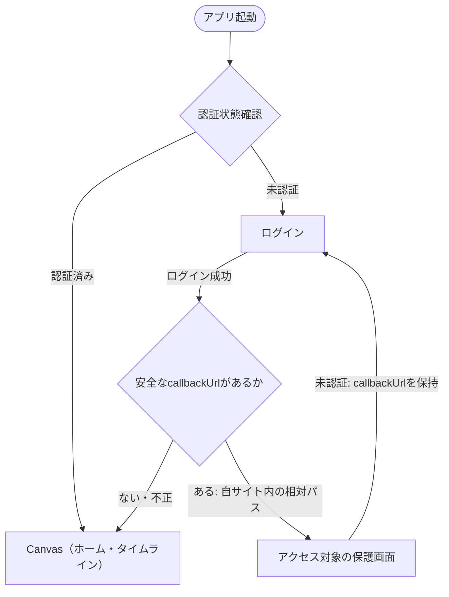

### ログイン関連の遷移

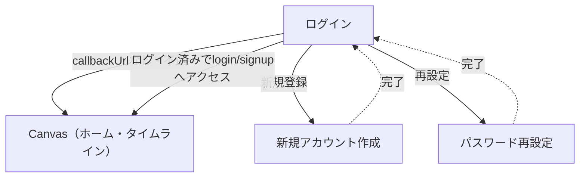

補足:
- 点線は、完了後にログインへ戻る遷移を表す
- 認証済みの場合はログインを経由せずCanvas（ホーム・タイムライン）へ進む
- ログイン成功時、安全な内部相対パスの `callbackUrl` があれば元の保護画面へ戻り、存在しない・不正な場合はCanvasへ進む
- 絶対URLや `//` 始まりなど、外部サイトへの遷移先は拒否する。検証の基本方針は [routing.md](./routing.md) を参照
- ログイン済みユーザーがパスワード再設定画面・ルートへアクセスした場合の扱いは、画面を実装する後工程でroutingの認証要件に従う
- ログイン状態の維持は画面遷移ではなく、起動時の認証状態確認で表現する
- 認証方式・セッション管理の詳細は後工程で検討
- 新規登録後はログインへ戻る。ログアウト成功後もログインへ遷移する

---

## 2. ユーザー側主要画面遷移

Canvas・Exploration・Inbox・投稿詳細・他ユーザープロフィールの間の画面遷移を、3つの図に分けて表す。

### ① Canvasからの画面遷移

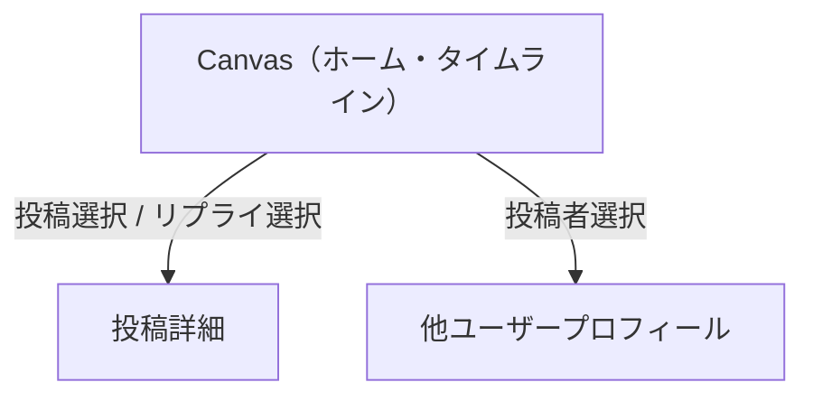

### ② Exploration・Inboxからの画面遷移

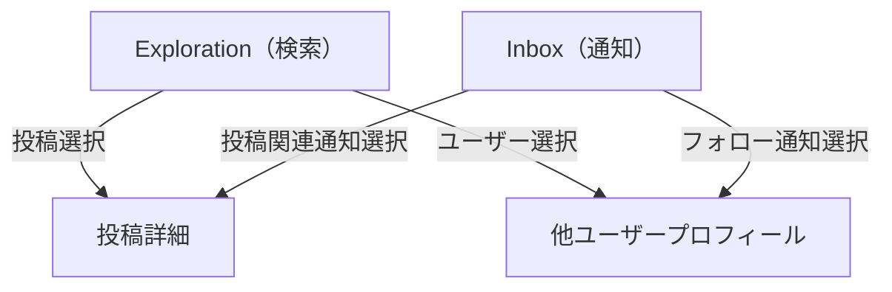

### ③ 投稿詳細・他ユーザープロフィール間の画面遷移

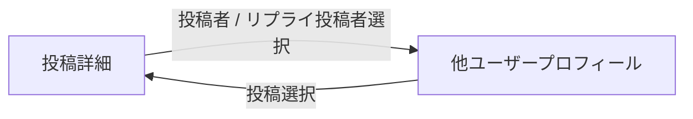

補足:
- いいね・リポストは同一画面内で完結し、画面遷移しない
- リプライを選択した場合は投稿詳細へ遷移する。リプライの入力・投稿は投稿詳細内で行い、リプライ専用画面は作成しない
- 投稿詳細と他ユーザープロフィールは相互に遷移できる
- My Pageへの遷移はヘッダーのMy Pageアイコンから行う（「8. 共通画面部品」参照）
- Canvas・Exploration・Inboxの切り替えはフッターで行う（「8. 共通画面部品」参照）
- 投稿作成モーダルの操作は「5. ユーザー側モーダル操作」に記載する

---

## 3. My Page・プロフィール周辺の画面遷移

My Pageを起点とした画面遷移を表す。タブやモーダルの内部処理は含めない。

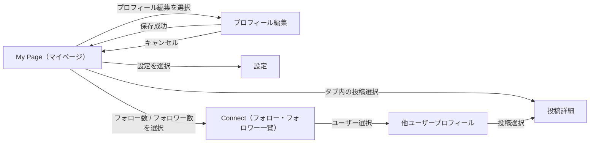

補足:
- プロフィール編集のキャンセルはMy Pageへ戻る。未保存の変更がある場合は変更破棄確認モーダルを経由する（「5. ユーザー側モーダル操作」参照）
- プロフィール編集画面はMVP対象だが、プロフィール画像・ヘッダー画像の変更処理は対象外
- 設定内の操作はモーダルであり、「5. ユーザー側モーダル操作」に記載する
- My Pageのタブの構造は「4. My Page・Connect一覧の内部構成」に記載する

---

## 4. My Page・Connect一覧の内部構成

画面遷移ではなく、画面内部の構成を表す。六角形はタブであり、独立画面ではない。

### My Pageのアクティビティタブ

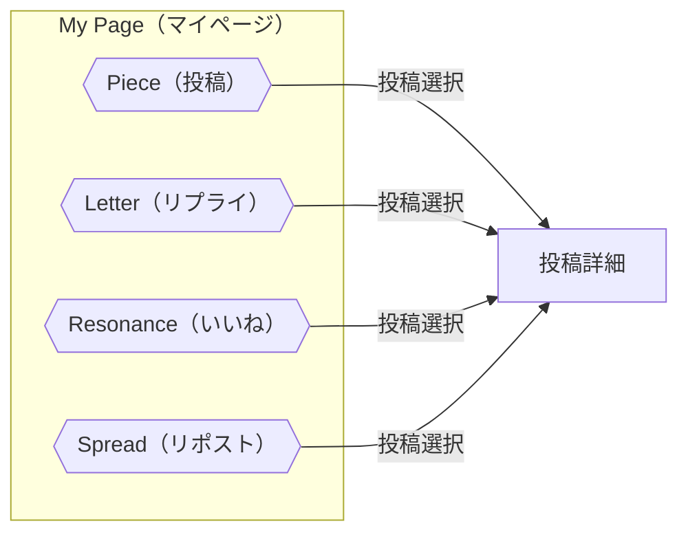

### Connect（フォロー・フォロワー一覧）のタブ

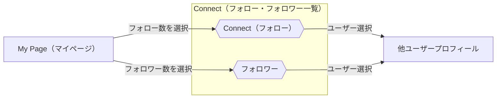

補足:
- タブの切り替えは画面遷移ではない。各タブ内の投稿を選択した場合のみ投稿詳細へ遷移する
- Connect（フォロー・フォロワー一覧）は1画面で、フォロー数選択時はフォロータブ、フォロワー数選択時はフォロワータブを初期表示する
- 他ユーザープロフィールのフォロー数・フォロワー数は表示のみで、一覧へは遷移しない

---

## 5. ユーザー側モーダル操作

モーダルの開閉と戻り先を表す。すべてのモーダルは独立画面ではない。

### 投稿作成モーダル

※ 元の画面とは、投稿作成モーダルを開いた既存の画面を指します。新しい独立画面ではありません。

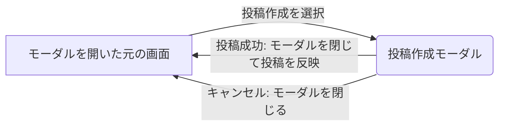

- 通常ユーザー画面から開く共通モーダルであり、独立したURLや画面を持たない
- 「元の画面」は新しい画面ではなく、モーダルを開いた画面を指す。Canvasへの固定遷移は行わない

### プロフィール編集

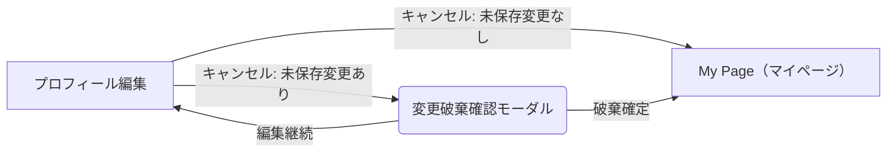

### 設定

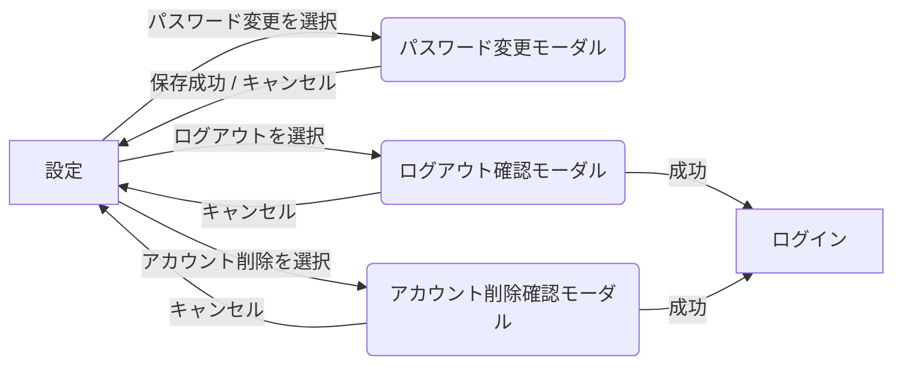

---

## 6. 管理者側画面遷移

管理者側の画面構成と画面間の遷移を表す。管理操作と確認モーダルは含めない。管理者側はユーザー側と別レイアウトで構成する。管理者機能は将来仕様として維持し、MVP対象外とする。

### ① 基本画面構成

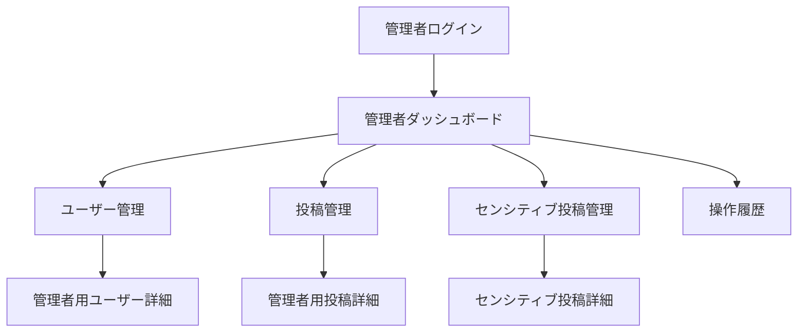

### ② 詳細画面への直接遷移

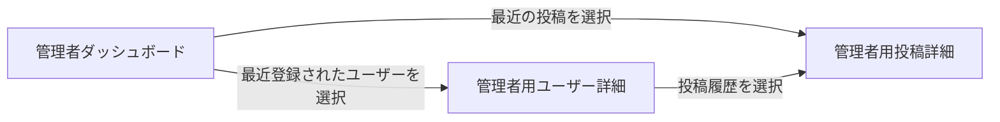

補足:
- 詳細画面の基本的な戻り先は元の管理一覧である（管理者用ユーザー詳細 → ユーザー管理、管理者用投稿詳細 → 投稿管理、センシティブ投稿詳細 → センシティブ投稿管理）
- 管理者ダッシュボードから直接遷移した場合の戻り先は未決定であり、固定しない
- 管理操作と確認モーダルは「7. 管理者側操作フロー」に記載する

---

## 7. 管理者側操作フロー

管理者による操作と確認モーダルを表す。操作は画面ではなく、確認モーダルも独立画面ではない。

### 管理者用ユーザー詳細・管理者用投稿詳細

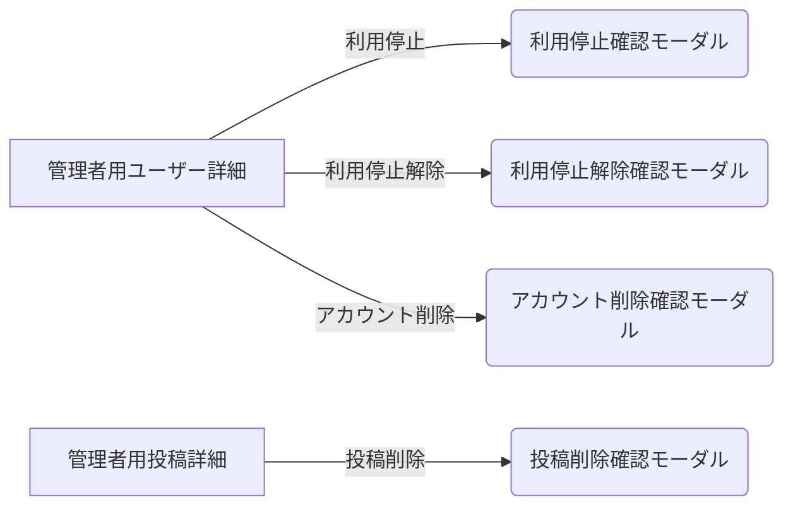

### センシティブ投稿詳細

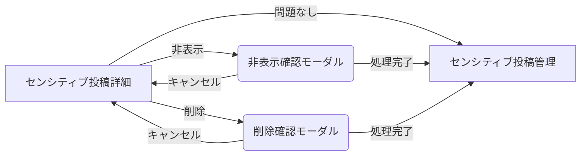

補足:
- 管理者用ユーザー詳細・管理者用投稿詳細の確認モーダル後の表示・遷移は未決定であり、ここでは定めない
- センシティブ投稿の候補の選定方法は図に含めない

---

## 8. 共通画面部品

ヘッダー・フッターの構成と遷移先を表す。

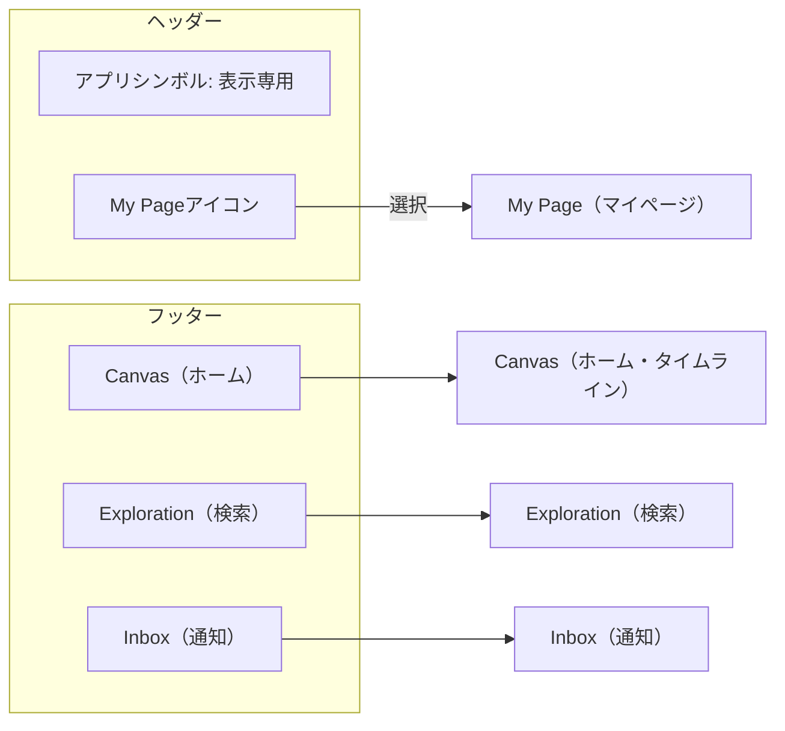

補足:
- ヘッダー: アプリシンボルを左端、My Pageアイコンを右端に配置する。アプリシンボルは表示専用で、クリック・画面遷移を持たない。My PageアイコンはMy Pageへ遷移する
- フッター: Canvas / Exploration / Inbox の共通ナビゲーションで、通常ユーザー画面で利用する。プロフィール編集・設定では通常フッターを表示しない。通知には未読バッジを表示可能とする
- 投稿作成: 共通の投稿作成モーダルとして利用し、独立画面ではない。操作フローは「5. ユーザー側モーダル操作」に記載する
